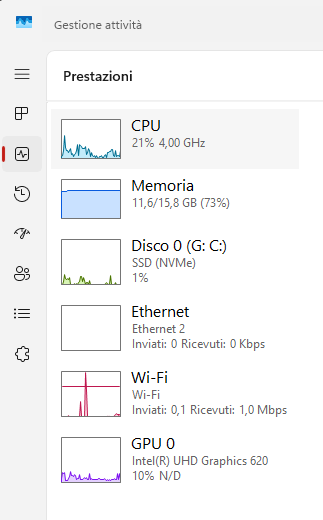
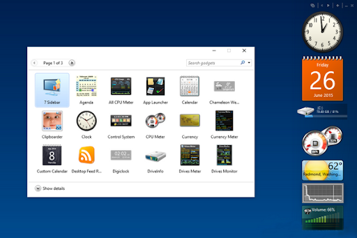
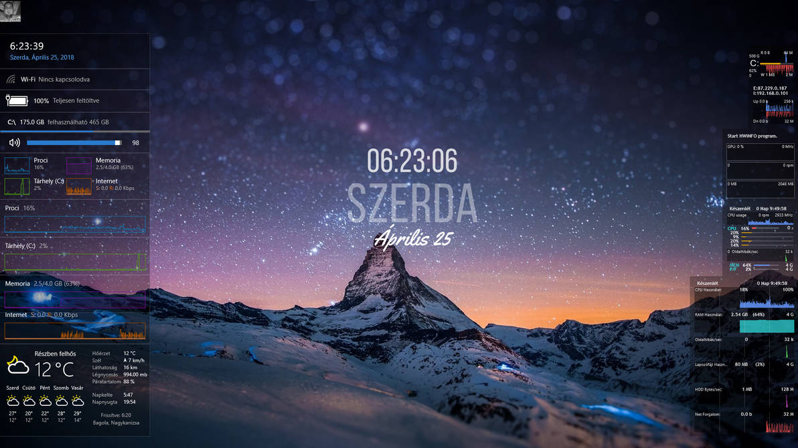

# L'abitudine
È da una vita che tengo visualizzato a schermo qualche indicatore sull'utilizzo delle risorse hardware, come cpu, ram, rete.  

Il motivo non è strettamente pratico, perché un colpetto di ++ mostra le stesse informazioni nel Task Manager di Windows, senza bisogno di installare nulla:  

Credo che si tratti solo del gusto di avere le cose sempre sott'occhio, magari in forma grafica (lancette, barre, istogrammi): da bambino scrivevo classifiche delle mie auto preferite in base a quanto mi piaceva il cruscotto, mica l'auto, e penso che la malattia sia rimasta più o meno quella.

# 30+ anni di "cruscotti"
Questo post fa parte della categoria "<a href='/blog/categories/amarcord/'>amarcord</a>" perché in questo capitolo riassumo cosa ho usato negli ultimi 30+ anni per ottenere quello che ho descritto qui sopra.  

## Win95/98/ME: Norton
Gli indicatori della suite di utility **Norton System Doctor** sono stati forse la prima cosa che ho incrociato:  

Ricordo che potevi fissarli ad un bordo dello schermo, in modo che restassero sempre in vista anche massimizzando la finestra dell'applicazione che stavi usando, al costo di un bel po' di spazio utile se pensi che al tempo i CRT più diffusi avevano risoluzioni SVGA (800x600) o XGA (1024x768).

## DUMeter/NetMeter
Per un lungo periodo, poco dopo l'arrivo di Internet nelle case, ancora con i modem analogici, ho usato [DUMeter](https://dumeter.net), successivamente sostituito con il quasi-clone gratuito [NetMeter](http://metal-machine.de/readerror/netmeter-evo), per mostrare soltanto l'occupazione di banda tramite una finestrella sempre in primo piano:  

## WinXP: Samurize
Su Windows XP ho scoperto e usato a lungo **Samurize**, un progetto oggi abbandonato di cui c'è ancora qualche cenno online (ad esempio [in Wikipedia](https://en.wikipedia.org/wiki/Comparison_of_widget_engines), insieme a tanti altri nomi di software simili).  
Ho dedicato ore a personalizzare la mia configurazione su desktop:  
  

... ma la cosa che preferivo in assoluto era che si potesse posizionare al posto dell'orologio standard di Windows, rimanendo così sempre in vista anche nell'uso fullscreen delle applicazioni, senza sovrapporsi ad altre cose:  

Questa possibilità di rimpiazzare l'orologio sulla taskbar purtroppo non funzionava più in Windows Vista, e probabilmente l'autore ha abbandonato il progetto in quel periodo.  

## Vista/Win7: gadget
Evidentemente la voglia di vedere indicatori a schermo non era una malattia solo mia, se Microsoft ha deciso di aggiungere a Windows Vista i **"gadget"**, disponibili anche sul successivo Win7.  

Ho usato per poco tempo quelli mediocri già disponibili nell'OS, e presto quelli molto migliori disponibili su [addgadgets.com](https://addgadgets.com).  
Scopro solo mentre sto scrivendo queste righe che i gadget si possono usare anche in Win10/Win11, grazie a [gadgetpack.net](https://gadgetpack.net).

## Rainmeter
Durante il percorso ho incrociato anche [Rainmeter](https://www.rainmeter.net):  
  

È ancora oggi molto noto nella community dei _modder_ perché consente personalizzazioni ben più spinte dell'intero desktop rispetto alle mie semplici esigenze, ma a parte qualche breve esperimento non lo ho mai usato.

## Win10/11: Desktop Info
Il penultimo software su questo tema è stato per me [Desktop Info](https://www.glenn.delahoy.com/desktopinfo):  

Interessante perché è free anche per uso business, è portable, è piuttosto configurabile, e si rivela utile anche su macchine remote come sostituto del più noto (ma ben più rudimentale) [BGInfo (oggi di Microsoft)](https://learn.microsoft.com/it-it/sysinternals/downloads/bginfo).  

# TrafficMonitor
Per ultimo, credo nel 2021, ho trovato un programmino che finalmente mi consente di vedere le informazioni che volevo nella taskbar di Windows come facevo con Samurize 20 anni prima, **TrafficMonitor**:  

Non ci posso fare esattamente quello che voglio, ma come pregi direi che fa subito quello che serve ed è molto minimale e discreto, il che lo rende molto appropriato anche in un contesto business.

Consiglio la **versione Lite** perché funziona senza privilegi amministrativi e si può eseguire "portable", e queste due caratteristiche consentono un agile utilizzo anche su PC aziendali gestiti rigorosamente.  
La versione completa richiede invece privilegi amministrativi per visualizzare informazioni sulla temperatura di alcuni componenti del PC, e qualche antivirus rileva un falso positivo sulla libreria usata per questa funzionalità.  

L'autore è cinese, ma il software e la documentazione sono discretamente tradotti anche in inglese. Ti linko la pagina inglese del progetto:  
 TrafficMonitor (inglese) su GitHub   
