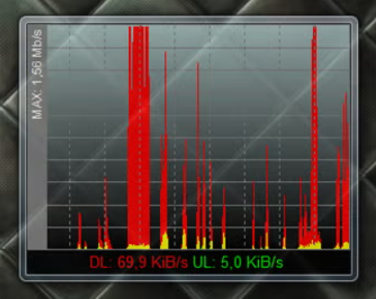
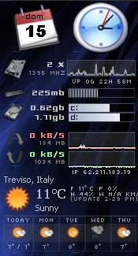
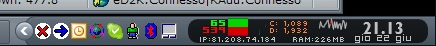

# L'abitudine
È da una vita che tengo visualizzato a schermo qualche indicatore sull'utilizzo delle risorse hardware, come cpu, ram, rete.  

Il motivo non è strettamente pratico, perché un colpetto di ++ mostra più o meno le stesse informazioni nel Task Manager di Windows, senza bisogno di installare nulla.  
Credo che si tratti solo del gusto di avere le cose sempre sott'occhio, magari in forma grafica (lancette, barre, istogrammi): da bambino scrivevo classifiche delle mie auto preferite in base a quanto mi piaceva il cruscotto, mica l'auto, e penso che la malattia sia rimasta più o meno quella.

# Un po' di amarcord
Negli anni ho usato vari programmi per ottenere la visualizzazione delle informazioni di cui ho scritto qui sopra.

## Win95/98/ME: Norton
Gli indicatori della suite di utility **Norton System Doctor** sono stati forse la prima cosa che ho incrociato:  

Ricordo che potevi fissarli ad un bordo dello schermo, in modo che restassero sempre in vista anche massimizzando la finestra dell'applicazione che stavi usando; solo che così ti mangiavi un bel po' di spazio utile, specie considerando che al tempo i CRT più diffusi avevano risoluzioni SVGA (800x600) o XGA (1024x768).

## DUMeter/NetMeter
Per un certo periodo ho usato [DUMeter](https://dumeter.net), successivamente sostituito con il quasi-clone gratuito [NetMeter](http://metal-machine.de/readerror/netmeter-evo), per mostrare soltanto l'occupazione di banda tramite una finestrella sempre in primo piano, che tenevo in alto sopra alla barra del titolo dell'applicazione in uso, oppure in basso sopra alla taskbar di Windows, sempre in modo da non coprire altri comandi:  

## WinXP: Samurize
Su Windows XP ho usato **Samurize**, un progetto oggi abbandonato di cui c'è ancora qualche cenno online (ad esempio [in Wikipedia](https://en.wikipedia.org/wiki/Comparison_of_widget_engines), insieme a tanti altri nomi di software simili).  
Era ottimo perché consentiva grande personalizzazione:  
  

... ma soprattutto perché si poteva posizionare nella taskbar di Windows, sostituendo l'orologio standard e rimanendo così sempre in vista senza occupare spazio utile, e anche nell'uso fullscreen delle applicazioni:  

Questa possibilità di rimpiazzare l'orologio di sistema purtroppo non funzionava più in Windows Vista, e probabilmente l'autore ha abbandonato il progetto in quel periodo.  
Quindi ho dovuto ripiegare di nuovo sul desktop.

## Vista/Win7: gadget
Su Windows Vista e 7 ho usato i **"Gadget"**, per poco tempo quelli scarsi già disponibili nell'OS, e presto altri molto migliori disponibili su [addgadgets.com](https://addgadgets.com).  
Scopro solo mentre sto scrivendo queste righe che i gadget si possono usare anche in Win10/Win11, grazie a [gadgetpack.net](https://gadgetpack.net).

## Rainmeter
Durante il percorso ho incrociato anche [Rainmeter](https://www.rainmeter.net), ancora oggi molto noto nella community dei _modder_, ma a parte qualche breve esperimento non lo ho mai usato.

## Win10/11: Desktop Info
Il penultimo software su questo tema è stato per me [Desktop Info](https://www.glenn.delahoy.com/desktopinfo), free, portable, configurabile, e utile anche su macchine remote come sostituto del più noto [BGInfo (oggi di Microsoft)](https://learn.microsoft.com/it-it/sysinternals/downloads/bginfo):  

# TrafficMonitor
E infine, credo nel 2021, ho trovato un programmino che finalmente mi consente di vedere le informazioni che volevo nella taskbar di Windows come facevo con Samurize 20 anni prima, **TrafficMonitor**:  

Certo non è altrettanto configurabile, ma fa subito quello che serve ed è molto minimale e discreto a schermo, che mi sembra vada benissimo anche in un contesto business.

Consiglio la **versione Lite** perché funziona senza privilegi amministrativi e si può eseguire "portable", e queste due caratteristiche consentono un agile utilizzo anche su PC aziendali gestiti rigorosamente.  
La versione completa richiede invece privilegi amministrativi per visualizzare informazioni sulla temperatura di alcuni componenti del PC, e qualche antivirus rileva un falso positivo sulla libreria usata per questa funzionalità.  

L'autore è cinese, ma il software e la documentazione sono discretamente tradotti anche in inglese. Ti linko la pagina inglese del progetto:  
 TrafficMonitor (inglese) su GitHub   
