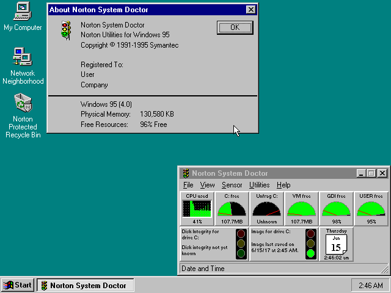
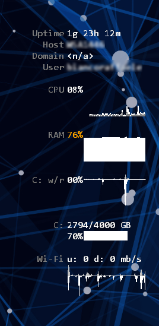

# L'abitudine
È da una vita che tengo visualizzati a schermo qualche indicatore sull'utilizzo delle risorse hardware, come cpu, ram, rete.  
Non c'è un vero motivo pratico, perché un colpetto di ++ mostra più o meno le stesse informazioni nel Task Manager di Windows, senza bisogno di installare nulla.  
Credo sia solo il gusto di avere le informazioni sempre sott'occhio, magari in forma grafica (lancette, barre, istogrammi): da bambino scrivevo classifiche delle mie auto preferite in base a quanto mi piaceva il cruscotto, mica l'auto, e penso che la malattia sia rimasta più o meno quella.

# Un po' di amarcord

## Win95/98/ME: Norton
Gli indicatori delle **Norton Utilities** facevano al caso:  

Ricordo che potevi fissarli al bordo superiore dello schermo, in modo che restassero sempre in vista anche massimizzando la finestra, al costo di un bel po' di spazio occupato in più a schermo - e al tempo i CRT più diffusi avevano risoluzione 800x600 o 1024x768... non proprio un buon uso dei pixel direi.

## WinXP: Samurize
Su Windows XP usavo **Samurize**, un progetto abbandonato di cui c'è ancora qualche cenno (ad esempio [in Wikipedia](https://en.wikipedia.org/wiki/Comparison_of_widget_engines), insieme a tanti altri nomi di software simili).  
Era ottimo perché consentiva grande personalizzazione:  
  

... ma soprattutto perché si poteva posizionare nella taskbar di Windows, sostituendo l'orologio standard e rimanendo così sempre in vista, anche nell'uso fullscreen delle applicazioni:  

Questa possibilità purtroppo non funzionava più in Windows Vista, e probabilmente l'autore ha abbandonato il progetto in quel periodo.  
Quindi ho dovuto ripiegare sulla visualizzazione grafica nel desktop.

# Vista/Win7: gadget
Su Windows Vista e 7 usavo i **"Gadget"**, sia quelli già disponibili nell'OS sia alcuni molto migliori disponibili su [addgadgets.com](https://addgadgets.com).  
Tra l'altro si possono usare anche con tutti i Windows successivi fino a Win11, grazie a [gadgetpack.net](https://gadgetpack.net).

Durante il percorso ho incrociato anche [Rainmeter](https://www.rainmeter.net), ancora oggi molto noto nella community dei _modder_, ma a parte qualche breve esperimento non lo ho mai usato.

# Win10/11: Desktop Info
Il penultimo software su questo tema è stato per me [Desktop Info](https://www.glenn.delahoy.com/desktopinfo), free, portable, configurabile, utile anche su macchine remote come sostituto del più noto [BGInfo (oggi di Microsoft)](https://learn.microsoft.com/it-it/sysinternals/downloads/bginfo), peccato che anche questo visualizza le cose sul desktop:  

# TrafficMonitor
E infine, credo nel 2021, ho trovato un programmino che finalmente riesce a posizionarsi nella taskbar di Windows come faceva Samurize 20 anni prima, **TrafficMonitor**:  

Certo non è altrettanto configurabile, ma fa subito quello che serve ed è molto discreto a schermo, che mi sembra vada benissimo anche in un contesto business.

Consiglio la versione Lite perché funziona senza privilegi amministrativi e si può eseguire "portable", e queste due caratteristiche insieme lo rendono perfetto per usarlo anche su PC aziendali ben gestiti.  
La versione completa richiede invece privilegi amministrativi per visualizzare informazioni sulla temperatura di alcuni componenti del PC, e qualche antivirus rileva un falso positivo sulla libreria usata per questa funzionalità.  

L'autore è cinese, ma il software e la documentazione sono discretamente tradotte anche in inglese. Ti linko la pagina in inglese:  
 TrafficMonitor (inglese) su GitHub   
